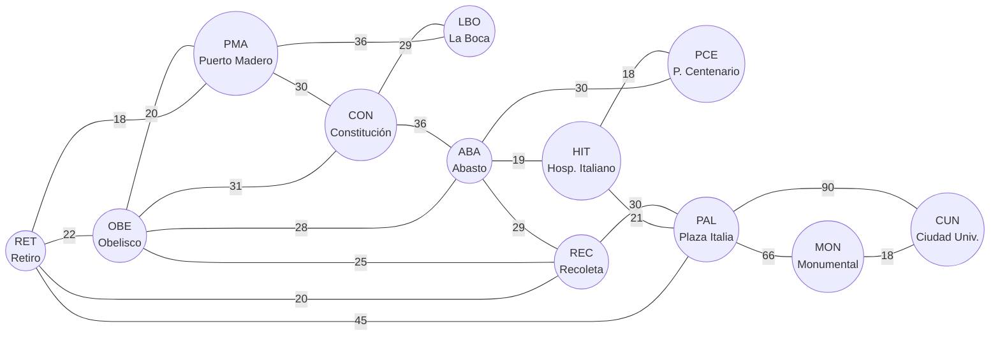

# TPO Programación III — Apocalipsis zombie en CABA

Trabajo Práctico Obligatorio de Programación III (UADE, 2º cuatrimestre 2026).
Dominio: **sobrevivir a un apocalipsis zombie moviéndose a pie entre refugios y puntos reales de la
Ciudad de Buenos Aires.** Los algoritmos responden preguntas como qué refugios se pueden alcanzar,
cuál es la ruta más rápida o qué suministros conviene llevar en la mochila.

Hecho sobre el scaffold de la cátedra (Spring Boot + Neo4j).

## Integrantes

| Nombre | Usuario de GitHub |
|---|---|
| Nicolás Albarellos | [NicoAlbarellos](https://github.com/NicoAlbarellos) |
| Juan Manuel Portnoy | [jmportnoy](https://github.com/jmportnoy) |
| Exequiel Campbell | [ExeCampbell](https://github.com/ExeCampbell) |

---

## Dominio

| Concepto | En el dominio |
|---|---|
| **Nodo** | Lugar real de CABA que sirve de refugio o punto de paso. Tiene un `tipo` (`REFUGIO`, `HOSPITAL`, `ESTACION`, `PUNTO`) y un `valor` = **capacidad del lugar en personas**. |
| **Arista** | Trayecto a pie entre dos lugares **vecinos** (como en un mapa real: no se conectan lugares lejanos). El grafo es **no dirigido**: cada calle se guarda una sola vez en Neo4j y, al cargarla en memoria, se agrega en ambos sentidos. |
| **Costo** | **Minutos a pie**, estimados a partir de la distancia real (Google Maps) a razón de ≈12 min/km. Todos los costos son positivos. |
| **Item** | **Suministro** que se puede llevar en la mochila: `peso` en **kg** y `valor` = **utilidad para sobrevivir** (puntos, sin unidad física). |

### Lugares (12 nodos)

| Id | Lugar | Tipo | Capacidad (personas) |
|---|---|---|---|
| ABA | Abasto | REFUGIO | 400 |
| CON | Constitución | ESTACION | 250 |
| CUN | Ciudad Universitaria | REFUGIO | 500 |
| HIT | Hospital Italiano | HOSPITAL | 200 |
| LBO | La Boca - Caminito | PUNTO | 60 |
| MON | Estadio Monumental | REFUGIO | 1000 |
| OBE | Obelisco | PUNTO | 80 |
| PAL | Plaza Italia - Palermo | PUNTO | 100 |
| PCE | Parque Centenario | REFUGIO | 150 |
| PMA | Puerto Madero | PUNTO | 120 |
| REC | Recoleta | PUNTO | 90 |
| RET | Estación Retiro | ESTACION | 300 |

### Calles (21 aristas, costo en minutos a pie)

| Calle | Min | Calle | Min | Calle | Min |
|---|---|---|---|---|---|
| RET – OBE | 22 | PMA – LBO | 36 | HIT – PCE | 18 |
| RET – PMA | 18 | PMA – CON | 30 | HIT – PAL | 21 |
| RET – REC | 20 | CON – LBO | 29 | REC – PAL | 30 |
| RET – PAL | 45 | CON – ABA | 36 | PAL – MON | 66 |
| OBE – PMA | 20 | ABA – HIT | 19 | MON – CUN | 18 |
| OBE – CON | 31 | ABA – PCE | 30 | PAL – CUN | 90 |
| OBE – ABA | 28 | ABA – REC | 29 | | |
| OBE – REC | 25 | | | | |

### Diagrama del grafo



### Decisiones sobre los datos

- **PAL – CUN cuesta 90, pero PAL → MON → CUN cuesta 66 + 18 = 84.** El camino directo no es el
  más rápido: sirve para verificar que Dijkstra hace bien la **relajación de aristas** (si devuelve
  90, está mal).
- **El árbol de recubrimiento mínimo es único, con costo total 287 minutos** (11 aristas = V − 1).
  Es único porque cada calle que queda afuera del árbol cuesta **estrictamente más** que todas las
  calles del camino que une sus extremos dentro del árbol (propiedad del ciclo). Así Prim y Kruskal
  tienen que devolver exactamente las mismas aristas, no solo el mismo costo. ABA – REC vale 29 y
  queda afuera del árbol: el camino ABA – OBE – PMA – RET – REC tiene como máximo 28 (OBE – ABA).
- **Grafo conexo y con costos positivos**: condiciones para Dijkstra, Prim y Kruskal.
- 12 vértices y 21 aristas: chico para verificarlo a mano, suficiente para que los resultados no
  sean triviales.

### Suministros (items)

| Id | Suministro | Peso (kg) | Utilidad | Dónde está |
|---|---|---|---|---|
| S1 | Botiquín | 3 | 50 | HIT |
| S2 | Comida enlatada | 4 | 40 | ABA |
| S3 | Agua 7L | 7 | 55 | PCE |
| S4 | Linterna | 1 | 8 | OBE |
| S5 | Radio | 2 | 14 | RET |
| S6 | Bate | 5 | 10 | MON |
| S7 | Bolsa de dormir | 6 | 30 | CUN |
| S8 | Herramientas | 5 | 24 | CON |

Los pesos y utilidades están elegidos para que, con una mochila de 12 kg, el greedy por ratio
utilidad/peso **no** dé el óptimo de la mochila 0/1: el greedy da 112 y la PD 119 (comparación con
números en [`docs/VERIFICACIONES.md`](docs/VERIFICACIONES.md#4-greedy-vs-mochila-01-con-pd)).

### Qué responde cada algoritmo en el dominio

| Algoritmo | Endpoint | Pregunta que responde | Estado |
|---|---|---|---|
| BFS | `GET /api/grafo/bfs` | ¿Qué lugares se alcanzan desde acá, por cantidad de tramos? | Implementado |
| DFS | `GET /api/grafo/dfs` | ¿Qué lugares se alcanzan desde acá, recorriendo en profundidad? | Implementado |
| Dijkstra | `GET /api/grafo/dijkstra` | Ruta más rápida (en minutos) entre dos refugios | Implementado |
| UCS | `GET /api/grafo/ucs` | Ruta más rápida entre dos refugios, cortando apenas el destino sale de la cola (compara nodos expandidos contra Dijkstra) | Implementado |
| Floyd-Warshall | `GET /api/grafo/floyd`, `/floyd/camino`, `/floyd/comparacion` | Tabla de tiempos mínimos entre todos los lugares, ruta entre dos lugares y comparación con Dijkstra | Implementado |
| Prim / Kruskal (Union-Find) | `GET /api/grafo/prim`, `/kruskal` | Mínimo de calles a despejar para conectar todos los refugios | Implementado |
| Backtracking | GET /api/grafo/rutas | Rutas de escape con tiempo máximo y cantidad máxima de paradas (informa nodos explorados con y sin poda) | Implementado |
| QuickSort / MergeSort | `GET /api/seleccion/quicksort`, `/mergesort` | Suministros ordenados por peso, utilidad o ratio | Implementado |
| Greedy | `GET /api/seleccion/greedy` | Qué llevar en la mochila eligiendo por ratio utilidad/peso | Implementado |
| Mochila 0/1 (PD) | `GET /api/seleccion/dinamica`, `/comparar` | Qué llevar en la mochila para maximizar la utilidad (óptimo), y comparación con el greedy | Implementado |
| Branch & Bound | GET /api/seleccion/repartir | Repartir los suministros entre k sobrevivientes minimizando la carga máxima (informa la cota, nodos explorados y podados) | Implementado |

El detalle de cada endpoint (parámetros, ejemplo real, complejidad y estructura) está en
[`docs/ENDPOINTS.md`](docs/ENDPOINTS.md). Los cálculos a mano sobre nuestro grafo (Dijkstra, Prim y
Kruskal paso a paso, greedy vs. mochila PD, Floyd, nodos con y sin poda del backtracking y la cota y los nodos podados del Branch & Bound) están en
[`docs/VERIFICACIONES.md`](docs/VERIFICACIONES.md). La tabla de complejidades de todos los
algoritmos (recurrencias, temporal, espacial y estructura) está en
[`docs/COMPLEJIDADES.md`](docs/COMPLEJIDADES.md).

Dijkstra (`/api/grafo/dijkstra`) y las rutas de escape (`/api/grafo/rutas`) aceptan además el
parámetro opcional `infectados` (ej. `infectados=MON,REC`): lugares que la ruta no puede pisar.

Para comprobar en un par de minutos que todo funciona, en
[`docs/PRUEBA-RAPIDA.md`](docs/PRUEBA-RAPIDA.md) hay URLs con su resultado esperado. Los términos
técnicos que usamos (relajación, UCS, Union-Find, poda por viabilidad y por optimalidad, cota
optimista, etc.) están explicados en [`docs/GLOSARIO.md`](docs/GLOSARIO.md).

## Demo visual

Con la aplicación levantada (`docker compose up -d` y `./mvnw spring-boot:run` con el `.env` cargado),
entrar a **http://localhost:8080/**. La página muestra el mapa de CABA con los 12 lugares y las calles
con su costo en minutos, y una pestaña por algoritmo (BFS/DFS, Dijkstra/Floyd, Prim/Kruskal,
Floyd vs. Dijkstra, Backtracking, Mochila, Branch & Bound y Ordenamiento) que llama al endpoint real
y resalta el resultado en el mapa. Es un único `index.html` sin dependencias externas: **no requiere
internet**.

---

## Cómo levantar el proyecto

Requisitos: Java 17 y Docker. Maven no hace falta: se usa el wrapper (`mvnw`).

### 1. Credenciales por variables de entorno

La password de Neo4j **nunca** va en el código ni en `application.properties`: se toma de variables
de entorno. Copiar la plantilla y completar `NEO4J_PASSWORD` (mínimo 8 caracteres). El `.env` está
en `.gitignore` y no se commitea.

```bash
cp .env.example .env
```

### 2. Levantar Neo4j en Docker

```bash
docker compose up -d
```

Navegador de Neo4j: http://localhost:7474

### 3. Cargar las variables y arrancar la aplicación

Bash (Linux, macOS, Git Bash):

```bash
export $(grep -v '^#' .env | xargs)
./mvnw spring-boot:run
```

PowerShell (Windows):

```powershell
Get-Content .env | Where-Object { $_ -match '^[^#].*=' } | ForEach-Object {
    $k, $v = $_ -split '=', 2; Set-Item "env:$k" $v
}
.\mvnw.cmd spring-boot:run
```

cmd (Windows):

```bat
for /f "eol=# tokens=1,* delims==" %a in (.env) do set "%a=%b"
mvnw.cmd spring-boot:run
```

**Primer arranque con la base vacía:** la aplicación carga sola los 12 lugares, las 21 calles y los
8 suministros antes de empezar a aceptar requests (log `Carga inicial completada`). Si la base
ya tiene datos, la carga no se repite.

### 4. Verificar

```bash
curl "http://localhost:8080/api/grafo/resumen"
# {"vertices":12,"aristas":21,"dirigido":false,"ids":["ABA","CON","CUN",...]}

curl "http://localhost:8080/api/grafo/bfs?origen=RET"
```

En `docs/api.http` hay requests listos para probar desde el IDE.

### Tests

```bash
./mvnw test
```

Los tests de algoritmos no necesitan Neo4j: arman el grafo en memoria (`GrafosDePrueba`) con el mismo
orden que la carga real, y los resultados esperados están calculados a mano.

### Resetear la base

Para borrar todos los datos y que la carga inicial vuelva a correr en el próximo arranque:

```bash
docker compose down -v
docker compose up -d
```

---

## Arquitectura

Arquitectura en capas, cada una con una sola responsabilidad:

```
controller/   Recibe el request, carga el grafo y delega. Sin lógica algorítmica.
algorithm/    Un algoritmo por clase (Recorridos, CaminosMinimos, ArbolRecubrimiento, ...).
service/      GrafoService carga el grafo desde Neo4j UNA vez por request;
              Grafo es la lista de adyacencia en memoria sobre la que trabajan los algoritmos.
repository/   Acceso a Neo4j (repositorios bloqueantes).
model/        Nodo, Conexion (arista con costo), Item.
seed/         CargaInicial: los datos del dominio.
config/       ManejadorDeErrores: errores como JSON (400/422/501), nunca un stack trace.
```

Los algoritmos **no consultan la base**: trabajan sobre el `Grafo` en memoria, así la complejidad
que se declara es la del algoritmo y no la del motor de base de datos. La carga ordena vértices y
aristas por id (`ORDER BY`), así que los recorridos son deterministas.

---

## Cómo agregar un refugio

Es la modificación más común sobre el mapa. Todos los datos del dominio están en un solo archivo,
`src/main/java/uade/prog3/tpo/seed/DominioCaba.java`, que usan tanto la carga en Neo4j como los tests.

1. **Agregar el lugar** en `LUGARES`, respetando el orden alfabético por id. El id no se puede
   repetir; el tipo es `REFUGIO`, `HOSPITAL`, `ESTACION` o `PUNTO`, y el último número es la
   capacidad en personas. Por ejemplo, entre `ABA` y `CON`:

   ```java
   new Lugar("BEL", "Barrancas de Belgrano", "REFUGIO", 300),
   ```

2. **Agregar sus calles** en `CALLES`, **una sola vez** cada una: el grafo es no dirigido y la
   vuelta se agrega sola al cargarlo en memoria. Solo se conectan lugares vecinos, con el costo en
   minutos a pie (≈12 min/km) y siempre positivo. La lista tiene que quedar **ordenada por origen y
   después por destino**, que es el orden del `ORDER BY` de `GrafoService`: así los tests ven las
   mismas listas de adyacencia que la aplicación. Por ejemplo, entre `ABA – REC` y `CON – ABA`:

   ```java
   new Calle("BEL", "MON", 20),
   ```

   Los dos ids de la calle tienen que existir en `LUGARES` (lo controla `DominioCabaTest`).

3. **Recargar la base.** La carga inicial solo corre si la base está vacía, así que hay que
   borrarla y volver a arrancar la aplicación:

   ```bash
   docker compose down -v
   docker compose up -d
   ```

   Al arrancar, el log tiene que decir `Carga inicial completada: 13 lugares de CABA, 22 calles, 8 suministros.`

4. **Actualizar los tests con valores fijos.** `./mvnw test` va a fallar en los tests que tienen
   resultados calculados a mano sobre el mapa de 12 lugares. Probando con `BEL – MON` (20 min)
   fallan 20 tests en 7 clases:

   | Clase | Tests | Qué hay que recalcular |
   |---|---|---|
   | `DominioCabaTest` | `tieneDoceLugaresVeintiunCallesYOchoSuministros` | Cantidad de lugares y calles |
   | `MapaTest` | `dominioCabaTiene12LugaresY21CallesSinRepetir` | Cantidad de lugares y calles del mapa de la demo |
   | `RecorridosTest` | `bfsDominioDesdeRetiro`, `dfsDominioDesdeRetiro`, `dominioTiene12VerticesY21Aristas` | Orden de visita y cantidad de vértices y aristas |
   | `ArbolRecubrimientoTest` | `primDominioDesdeRetiro`, `primDominioDaElMismoArbolDesdeOtroOrigen`, `kruskalDominio` | Aristas del árbol (V − 1) y costo total (si el refugio tiene una sola calle, 287 + esa calle) |
   | `FloydWarshallTest` | `dominioTieneTodosLosParesYDiagonalCero`, `sumaDeTodasLasDistancias`, `comparacionConDijkstraEnElDominio` | Cantidad de pares (V²), suma de todas las distancias y cantidad de orígenes comparados |
   | `UcsTest` | `palermoACiudadUniversitaria`, `retiroACiudadUniversitariaExpandeTodo`, `laBocaAHospitalItalianoCortaTemprano` | Nodos expandidos por Dijkstra (siempre V) y, si cambia el orden de la cola, los de UCS |
   | `BacktrackingTest` | `retiroCiudadUniversitaria150Minutos4Saltos`, `retiroCiudadUniversitaria130Minutos`, `constitucionParqueCentenario`, `obeliscoHospitalItaliano`, `sinRutasValidas`, `limitesHolgadosDanTodosLosCaminosSimples` | Nodos explorados con y sin poda |

   `CaminosMinimosTest` y `LugaresInfectadosTest` siguen pasando mientras la calle nueva no acorte
   ninguno de sus caminos; si los acorta, hay que recalcular esas rutas y las de Backtracking. Los
   tests de ordenamiento, mochila, Branch & Bound e `ItemTest` no cambian: dependen de los
   suministros, no del mapa.

5. **Actualizar la documentación:** las tablas de lugares y calles y el diagrama de este README, y
   los resultados esperados en `docs/VERIFICACIONES.md` y `docs/api.http`.

6. **Demo (opcional):** agregar las coordenadas del lugar en `COORDENADAS` de
   `src/main/resources/static/index.html`. Si no se agregan, el lugar igual aparece en el mapa,
   dibujado cerca de sus vecinos.

---

## Uso de IA

Usamos **Claude Code (Anthropic)** como asistente durante el trabajo, para:

- discutir y cuestionar el diseño del dominio y de cada algoritmo antes de programarlo;
- implementación asistida de algoritmos y tests;
- revisión de código (correctitud, legibilidad, reglas de la consigna);
- redacción de la documentación (este README, `docs/ENDPOINTS.md`, `docs/VERIFICACIONES.md`,
  `docs/COMPLEJIDADES.md`).

Todo el código y la documentación fueron revisados y entendidos por el grupo. Los resultados
esperados de los tests y las verificaciones se calcularon a mano sobre nuestro grafo.
