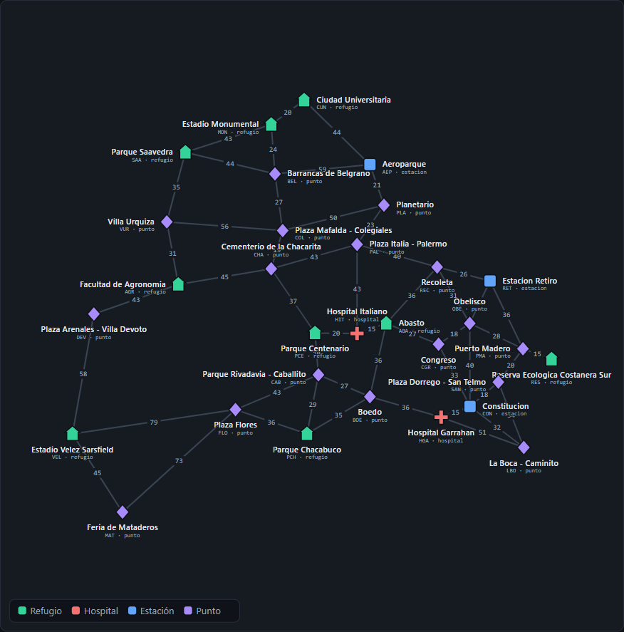

# TPO Programación III - Apocalipsis zombie en CABA

Trabajo Práctico Obligatorio de Programación III (UADE, 2º cuatrimestre 2026).
Dominio: **sobrevivir a un apocalipsis zombie moviéndose a pie entre refugios y puntos reales de la
Ciudad de Buenos Aires.** Los algoritmos responden preguntas como qué refugios se pueden alcanzar,
cuál es la ruta más rápida o qué suministros conviene llevar en la mochila.

Hecho sobre el scaffold de la cátedra (Spring Boot + Neo4j).

## Integrantes

| Nombre | Usuario de GitHub |
|---|---|
| Nicolás Albarellos | [NicoAlbarellos](https://github.com/NicoAlbarellos) |
| Juan Manuel Portnoy | [jmportnoy](https://github.com/jmportnoy) |
| Exequiel Campbell | [ExeCampbell](https://github.com/ExeCampbell) |

---

## Dominio

| Concepto | En el dominio |
|---|---|
| **Nodo** | Lugar real de CABA que sirve de refugio o punto de paso. Tiene un `tipo` (`REFUGIO`, `HOSPITAL`, `ESTACION`, `PUNTO`) y un `valor` = **capacidad del lugar en personas**. |
| **Arista** | Trayecto a pie entre dos lugares **vecinos** (como en un mapa real: no se conectan lugares lejanos y ninguna calle se cruza con otra). El grafo es **no dirigido**: cada calle se guarda una sola vez en Neo4j y, al cargarla en memoria, se agrega en ambos sentidos. |
| **Costo** | **Minutos a pie**, calculados con una fórmula a partir de las coordenadas reales de los dos lugares (ver [Cómo se calcula el costo](#cómo-se-calcula-el-costo-de-una-calle)). Todos los costos son positivos. |
| **Item** | **Suministro** que se puede llevar en la mochila: `peso` en **kg** y `valor` = **utilidad para sobrevivir** (puntos, sin unidad física). |

Todos los datos del dominio están en un solo archivo,
`src/main/java/uade/prog3/tpo/seed/DominioCaba.java`, que usan tanto la carga en Neo4j como los tests.

### Mapa



Captura de la [demo visual](#demo-visual) (`http://localhost:8080/`): los 31 lugares y las 51 calles
con su costo en minutos.

Por zona, para ubicarse en el mapa:

- **Centro y sur:** RET, OBE, CGR, PMA, RES, SAN, CON, HGA, LBO.
- **Norte (Recoleta, Palermo, costanera):** REC, PAL, PLA, AEP.
- **Centro geográfico:** ABA, HIT, PCE, CAB, BOE, PCH.
- **Noroeste (Belgrano, Núñez, Saavedra, Urquiza):** COL, CHA, BEL, MON, CUN, SAA, VUR.
- **Oeste:** AGR, DEV, FLO, VEL, MAT.

### Lugares (31 nodos)

| Id | Lugar | Tipo | Capacidad (personas) |
|---|---|---|---|
| ABA | Abasto | REFUGIO | 400 |
| AEP | Aeroparque | ESTACION | 350 |
| AGR | Facultad de Agronomía | REFUGIO | 600 |
| BEL | Barrancas de Belgrano | PUNTO | 80 |
| BOE | Boedo | PUNTO | 70 |
| CAB | Parque Rivadavia - Caballito | PUNTO | 90 |
| CGR | Congreso | PUNTO | 100 |
| CHA | Cementerio de la Chacarita | PUNTO | 50 |
| COL | Plaza Mafalda - Colegiales | PUNTO | 60 |
| CON | Constitución | ESTACION | 250 |
| CUN | Ciudad Universitaria | REFUGIO | 500 |
| DEV | Plaza Arenales - Villa Devoto | PUNTO | 70 |
| FLO | Plaza Flores | PUNTO | 90 |
| HGA | Hospital Garrahan | HOSPITAL | 300 |
| HIT | Hospital Italiano | HOSPITAL | 200 |
| LBO | La Boca - Caminito | PUNTO | 60 |
| MAT | Feria de Mataderos | PUNTO | 80 |
| MON | Estadio Monumental | REFUGIO | 1000 |
| OBE | Obelisco | PUNTO | 80 |
| PAL | Plaza Italia - Palermo | PUNTO | 100 |
| PCE | Parque Centenario | REFUGIO | 150 |
| PCH | Parque Chacabuco | REFUGIO | 200 |
| PLA | Planetario | PUNTO | 70 |
| PMA | Puerto Madero | PUNTO | 120 |
| REC | Recoleta | PUNTO | 90 |
| RES | Reserva Ecológica Costanera Sur | REFUGIO | 300 |
| RET | Estación Retiro | ESTACION | 300 |
| SAA | Parque Saavedra | REFUGIO | 250 |
| SAN | Plaza Dorrego - San Telmo | PUNTO | 70 |
| VEL | Estadio Vélez Sarsfield | REFUGIO | 800 |
| VUR | Villa Urquiza | PUNTO | 80 |

### Calles (51 aristas, costo en minutos a pie)

Ordenadas por (origen, destino), que es como están escritas en `DominioCaba` y como las devuelve
el `ORDER BY` de `GrafoService`. "Km" es la distancia en línea recta entre los dos lugares.

| # | Calle | Km | Factor | Min |
|---|---|---|---|---|
| 1 | ABA – BOE | 2,40 | 1,25 | 36 |
| 2 | ABA – CGR | 1,80 | 1,25 | 27 |
| 3 | ABA – HIT | 0,99 | 1,25 | 15 |
| 4 | ABA – REC | 2,43 | 1,25 | 36 |
| 5 | AEP – BEL | 3,06 | **1,6** | 59 |
| 6 | AEP – CUN | 2,94 | 1,25 | 44 |
| 7 | AEP – PLA | 1,38 | 1,25 | 21 |
| 8 | AGR – CHA | 3,02 | 1,25 | 45 |
| 9 | AGR – DEV | 2,86 | 1,25 | 43 |
| 10 | AGR – VUR | 2,03 | 1,25 | 31 |
| 11 | BEL – COL | 1,83 | 1,25 | 27 |
| 12 | BEL – MON | 1,58 | 1,25 | 24 |
| 13 | BEL – SAA | 2,95 | 1,25 | 44 |
| 14 | BOE – CAB | 1,79 | 1,25 | 27 |
| 15 | BOE – HGA | 2,37 | 1,25 | 36 |
| 16 | BOE – PCH | 2,34 | 1,25 | 35 |
| 17 | CAB – FLO | 2,88 | 1,25 | 43 |
| 18 | CAB – PCE | 1,34 | 1,25 | 20 |
| 19 | CAB – PCH | 1,93 | 1,25 | 29 |
| 20 | CGR – CON | 2,23 | 1,25 | 33 |
| 21 | CGR – OBE | 1,20 | 1,25 | 18 |
| 22 | CHA – COL | 1,28 | 1,25 | 19 |
| 23 | CHA – PAL | 2,85 | 1,25 | 43 |
| 24 | CHA – PCE | 2,49 | 1,25 | 37 |
| 25 | COL – PLA | 3,34 | 1,25 | 50 |
| 26 | COL – VUR | 3,72 | 1,25 | 56 |
| 27 | CON – HGA | 0,99 | 1,25 | 15 |
| 28 | CON – LBO | 2,16 | 1,25 | 32 |
| 29 | CON – OBE | 2,66 | 1,25 | 40 |
| 30 | CON – SAN | 1,19 | 1,25 | 18 |
| 31 | CUN – MON | 1,31 | 1,25 | 20 |
| 32 | DEV – VEL | 3,90 | 1,25 | 58 |
| 33 | FLO – MAT | 4,88 | 1,25 | 73 |
| 34 | FLO – PCH | 2,42 | 1,25 | 36 |
| 35 | FLO – VEL | 5,27 | 1,25 | 79 |
| 36 | HGA – LBO | 2,82 | **1,5** | 51 |
| 37 | HIT – PAL | 2,85 | 1,25 | 43 |
| 38 | HIT – PCE | 1,35 | 1,25 | 20 |
| 39 | LBO – SAN | 2,24 | 1,25 | 34 |
| 40 | MAT – VEL | 2,97 | 1,25 | 45 |
| 41 | MON – SAA | 2,89 | 1,25 | 43 |
| 42 | OBE – PMA | 1,89 | 1,25 | 28 |
| 43 | OBE – REC | 2,08 | 1,25 | 31 |
| 44 | OBE – RET | 1,50 | 1,25 | 23 |
| 45 | PAL – PLA | 1,52 | 1,25 | 23 |
| 46 | PAL – REC | 2,66 | 1,25 | 40 |
| 47 | PMA – RES | 0,97 | 1,25 | 15 |
| 48 | PMA – RET | 2,41 | 1,25 | 36 |
| 49 | PMA – SAN | 1,33 | 1,25 | 20 |
| 50 | REC – RET | 1,75 | 1,25 | 26 |
| 51 | SAA – VUR | 2,30 | 1,25 | 35 |

Suma de los 51 costos: 1782 minutos (lo verifica `MapaTest`).

### Cómo se calcula el costo de una calle

```
minutos = redondeo( km en línea recta × factor × 12 min/km )
```

- **Km en línea recta:** distancia entre las coordenadas (latitud, longitud) reales de los dos
  lugares, con la **fórmula de haversine** (distancia sobre la superficie de la Tierra entre dos
  puntos dados por latitud y longitud).
- **Factor 1,25:** caminando por la calle se recorre más que la línea recta (hay que seguir la
  cuadrícula de manzanas). 1,25 es un factor de rodeo típico para una ciudad en damero.
- **12 min/km:** velocidad de caminata de 5 km/h.
- **Dos excepciones con rodeo real**, donde la línea recta está cortada por obstáculos:
  - **AEP – BEL, factor 1,6:** entre Aeroparque y Barrancas de Belgrano están las vías del Mitre,
    la Av. Lugones y el cerco del aeropuerto; hay que buscar los pocos cruces.
  - **HGA – LBO, factor 1,5:** entre el Garrahan y La Boca están las vías del Roca y la Autopista
    9 de Julio Sur, con pocos pasos.

Ejemplo: OBE – RET está a 1,50 km en línea recta → 1,50 × 1,25 × 12 = 22,6 → **23 minutos**.

**Por qué cambiaron costos de las calles originales.** El mapa empezó con 12 lugares y 21 calles,
con costos estimados a mano. Al ampliarlo a 31 lugares:

- se recalcularon **todas** las calles con la misma fórmula, para que los costos sean consistentes
  entre sí y reproducibles (por ejemplo, RET – PMA pasó de 18 a 36: está a 2,41 km en línea recta,
  y 18 minutos era demasiado poco; HIT – PAL pasó de 21 a 43, ABA – HIT de 19 a 15);
- se sacaron las 8 calles viejas que dejaron de unir lugares **vecinos**, porque ahora hay un lugar
  en el medio: ABA – PCE, CON – ABA, OBE – ABA, PAL – CUN, PAL – MON, PMA – CON, PMA – LBO y
  RET – PAL (por ejemplo, de Palermo a Ciudad Universitaria ahora se pasa por el Planetario y
  Aeroparque).

### Decisiones sobre los datos

- **HGA – LBO cuesta 51, pero HGA → CON → LBO cuesta 15 + 32 = 47.** La calle directa no es la ruta
  más rápida: sirve para verificar que Dijkstra hace bien la **relajación de aristas**. Al expandir
  HGA, LBO entra a la cola con 51 (calle directa); al expandir CON (15) baja a 47. Si el endpoint
  devolviera 51, la relajación estaría mal. Con CON infectado sí se usa la directa (51).
- **El árbol de recubrimiento mínimo es único, con costo total 835 minutos** (30 aristas = V − 1).
  Es único porque cada calle que queda afuera del árbol cuesta **estrictamente más** que todas las
  calles del camino que une sus extremos dentro del árbol (propiedad del ciclo). Así Prim y Kruskal
  tienen que devolver exactamente las mismas aristas, no solo el mismo costo. Ejemplos: HGA – LBO
  (51) queda afuera porque en el árbol HGA – CON – LBO tiene como máximo 32; CHA – PAL (43) queda
  afuera porque el camino del árbol CHA – PCE – HIT – ABA – CGR – OBE – RET – REC – PAL tiene como
  máximo 40 (REC – PAL).
- **Ningún par de lugares tiene dos caminos mínimos empatados** (verificado para los 961 pares). Así
  Dijkstra, UCS y Floyd devuelven siempre el mismo camino, sin depender de cómo desempata la cola de
  prioridad, y los tests no dependen del desempate.
- **RES (Reserva Ecológica) es una hoja:** solo tiene la calle a PMA (Puerto Madero), que es el único
  punto de articulación del grafo. Sirve para mostrar lugares infectados que aíslan un refugio: con
  PMA infectado no hay camino a RES (422).
- **Grafo conexo, plano y con costos positivos**: condiciones para Dijkstra, Prim y Kruskal; ninguna
  calle se cruza con otra en el mapa.
- **Tamaño:** 31 vértices y 51 aristas (grado promedio 3,29; máximo 5, en CON y OBE). Es **disperso**
  (51 de las 465 calles posibles), como cualquier mapa a pie. Es chico para seguir a mano los
  ejemplos, pero suficiente para que la poda se note: sin poda, el backtracking desde Retiro recorre
  807.257 nodos.

### Suministros (items)

| Id | Suministro | Peso (kg) | Utilidad | Dónde está |
|---|---|---|---|---|
| S1 | Botiquín | 3 | 50 | HIT |
| S2 | Comida enlatada | 4 | 40 | ABA |
| S3 | Agua 7L | 7 | 55 | PCE |
| S4 | Linterna | 1 | 8 | OBE |
| S5 | Radio | 2 | 14 | RET |
| S6 | Bate | 5 | 10 | MON |
| S7 | Bolsa de dormir | 6 | 30 | CUN |
| S8 | Herramientas | 5 | 24 | CON |

Los pesos y utilidades están elegidos para que, con una mochila de 12 kg, el greedy por ratio
utilidad/peso **no** dé el óptimo de la mochila 0/1: el greedy da 112 y la PD 119 (comparación con
números en [`docs/VERIFICACIONES.md`](docs/VERIFICACIONES.md#4-greedy-vs-mochila-01-con-pd)).

### Qué responde cada algoritmo en el dominio

| Algoritmo | Endpoint | Pregunta que responde | Estado |
|---|---|---|---|
| BFS | `GET /api/grafo/bfs` | ¿Qué lugares se alcanzan desde acá, por cantidad de tramos? | Implementado |
| DFS | `GET /api/grafo/dfs` | ¿Qué lugares se alcanzan desde acá, recorriendo en profundidad? | Implementado |
| Dijkstra | `GET /api/grafo/dijkstra` | Ruta más rápida (en minutos) entre dos refugios | Implementado |
| UCS | `GET /api/grafo/ucs` | Ruta más rápida entre dos refugios, cortando apenas el destino sale de la cola (compara nodos expandidos contra Dijkstra) | Implementado |
| Floyd-Warshall | `GET /api/grafo/floyd`, `/floyd/camino`, `/floyd/comparacion` | Tabla de tiempos mínimos entre todos los lugares, ruta entre dos lugares y comparación con Dijkstra | Implementado |
| Prim / Kruskal (Union-Find) | `GET /api/grafo/prim`, `/kruskal` | Mínimo de calles a despejar para conectar todos los refugios | Implementado |
| Backtracking | `GET /api/grafo/rutas` | Rutas de escape con tiempo máximo y cantidad máxima de paradas (informa nodos explorados con y sin poda) | Implementado |
| QuickSort / MergeSort | `GET /api/seleccion/quicksort`, `/mergesort` | Suministros ordenados por peso, utilidad o ratio | Implementado |
| Greedy | `GET /api/seleccion/greedy` | Qué llevar en la mochila eligiendo por ratio utilidad/peso | Implementado |
| Mochila 0/1 (PD) | `GET /api/seleccion/dinamica`, `/comparar` | Qué llevar en la mochila para maximizar la utilidad (óptimo), y comparación con el greedy | Implementado |
| Branch & Bound | `GET /api/seleccion/repartir` | Repartir los suministros entre k sobrevivientes minimizando la carga máxima (informa la cota, nodos explorados y podados) | Implementado |

Algunos resultados sobre nuestro mapa: la ruta más rápida de Retiro a Ciudad Universitaria es
RET – REC – PAL – PLA – AEP – CUN (154 min); despejar el mínimo de calles para conectar los 31
lugares cuesta 835 minutos (30 calles); y las rutas de escape de Retiro a Ciudad Universitaria con
los límites por defecto (200 min, 8 tramos) son 3.

El detalle de cada endpoint (parámetros, ejemplo real, complejidad y estructura) está en
[`docs/ENDPOINTS.md`](docs/ENDPOINTS.md). Los cálculos a mano sobre nuestro grafo (Dijkstra, Prim y
Kruskal paso a paso, greedy vs. mochila PD, Floyd, nodos con y sin poda del backtracking y la cota y
los nodos podados del Branch & Bound) están en
[`docs/VERIFICACIONES.md`](docs/VERIFICACIONES.md). La tabla de complejidades de todos los
algoritmos (recurrencias, temporal, espacial y estructura) está en
[`docs/COMPLEJIDADES.md`](docs/COMPLEJIDADES.md).

Dijkstra (`/api/grafo/dijkstra`) y las rutas de escape (`/api/grafo/rutas`) aceptan además el
parámetro opcional `infectados` (ej. `infectados=CON,PLA`): lugares que la ruta no puede pisar.

Para comprobar en un par de minutos que todo funciona, en
[`docs/PRUEBA-RAPIDA.md`](docs/PRUEBA-RAPIDA.md) hay URLs con su resultado esperado. Los términos
técnicos que usamos (relajación, UCS, Union-Find, poda por viabilidad y por optimalidad, cota
optimista, etc.) están explicados en [`docs/GLOSARIO.md`](docs/GLOSARIO.md).

## Demo visual

Con la aplicación levantada (`docker compose up -d` y `./mvnw spring-boot:run` con el `.env` cargado),
entrar a **http://localhost:8080/**. La página muestra el mapa de CABA con los 31 lugares y las 51
calles con su costo en minutos, y una pestaña por algoritmo (BFS/DFS, Dijkstra/Floyd, Prim/Kruskal,
Floyd vs. Dijkstra, Backtracking, Mochila, Branch & Bound y Ordenamiento) que llama al endpoint real
y resalta el resultado en el mapa. Es un único `index.html` sin dependencias externas: **no requiere
internet**.

---

## Cómo levantar el proyecto

Requisitos: Java 17 y Docker. Maven no hace falta: se usa el wrapper (`mvnw`).

### 1. Credenciales por variables de entorno

La password de Neo4j **nunca** va en el código ni en `application.properties`: se toma de variables
de entorno. Copiar la plantilla y completar `NEO4J_PASSWORD` (mínimo 8 caracteres). El `.env` está
en `.gitignore` y no se commitea.

```bash
cp .env.example .env
```

### 2. Levantar Neo4j en Docker

```bash
docker compose up -d
```

Navegador de Neo4j: http://localhost:7474

> **Si ya habías levantado el proyecto antes de la ampliación del mapa**, borrá la base una vez con
> `docker compose down -v` y volvé a levantarla con `docker compose up -d`. La carga inicial solo
> corre con la base vacía: una base que ya tiene el mapa viejo (12 lugares) **no se recarga sola**.

### 3. Cargar las variables y arrancar la aplicación

Bash (Linux, macOS, Git Bash):

```bash
export $(grep -v '^#' .env | xargs)
./mvnw spring-boot:run
```

PowerShell (Windows):

```powershell
Get-Content .env | Where-Object { $_ -match '^[^#].*=' } | ForEach-Object {
    $k, $v = $_ -split '=', 2; Set-Item "env:$k" $v
}
.\mvnw.cmd spring-boot:run
```

cmd (Windows):

```bat
for /f "eol=# tokens=1,* delims==" %a in (.env) do set "%a=%b"
mvnw.cmd spring-boot:run
```

**Primer arranque con la base vacía:** la aplicación carga sola los 31 lugares, las 51 calles y los
8 suministros antes de empezar a aceptar requests (log
`Carga inicial completada: 31 lugares de CABA, 51 calles, 8 suministros.`). Si la base ya tiene
datos, la carga no se repite.

### 4. Verificar

```bash
curl "http://localhost:8080/api/grafo/resumen"
# {"vertices":31,"aristas":51,"dirigido":false,"ids":["ABA","AEP","AGR",...]}

curl "http://localhost:8080/api/grafo/bfs?origen=RET"
```

Si `/resumen` devuelve 12 vértices, la base tiene el mapa viejo: ver el aviso del paso 2.

En `docs/api.http` hay requests listos para probar desde el IDE.

### Tests

```bash
./mvnw test
```

Los tests de algoritmos no necesitan Neo4j: arman el grafo en memoria (`GrafosDePrueba`) con el mismo
orden que la carga real, y los resultados esperados están calculados a mano.

### Resetear la base

Para borrar todos los datos y que la carga inicial vuelva a correr en el próximo arranque:

```bash
docker compose down -v
docker compose up -d
```

---

## Arquitectura

Arquitectura en capas, cada una con una sola responsabilidad:

```
controller/   Recibe el request, carga el grafo y delega. Sin lógica algorítmica.
algorithm/    Un algoritmo por clase (Recorridos, CaminosMinimos, ArbolRecubrimiento, ...).
service/      GrafoService carga el grafo desde Neo4j UNA vez por request;
              Grafo es la lista de adyacencia en memoria sobre la que trabajan los algoritmos.
repository/   Acceso a Neo4j (repositorios bloqueantes).
model/        Nodo, Conexion (arista con costo), Item.
seed/         DominioCaba (los datos del dominio) y CargaInicial (los guarda en Neo4j).
config/       ManejadorDeErrores: errores como JSON (400/422/501), nunca un stack trace.
```

Los algoritmos **no consultan la base**: trabajan sobre el `Grafo` en memoria, así la complejidad
que se declara es la del algoritmo y no la del motor de base de datos. La carga ordena vértices y
aristas por id (`ORDER BY`), así que los recorridos son deterministas.

**Carga del dominio (`CargaInicial`).** Corre al arrancar, antes de aceptar requests, y solo si la
base está vacía. Guarda los lugares y los suministros con los repositorios, y **las 51 calles en una
sola consulta Cypher con `UNWIND`** (una transacción, atómica): o se crean todas o ninguna. Después
verifica que la consulta haya creado exactamente las 51; si no (por ejemplo, una calle con un id de
lugar que no existe), falla con un error claro en lugar de dejar un mapa incompleto.

---

## Cómo agregar un refugio

Es la modificación más común sobre el mapa. Todos los datos del dominio están en
`src/main/java/uade/prog3/tpo/seed/DominioCaba.java`. Ejemplo: agregar **Villa Lugano** (`LUG`),
al sur de Mataderos, conectado con Mataderos y con Flores.

1. **Agregar el lugar** en `LUGARES`, respetando el orden alfabético por id. El id no se puede
   repetir; el tipo es `REFUGIO`, `HOSPITAL`, `ESTACION` o `PUNTO`, y el último número es la
   capacidad en personas. `LUG` va entre `LBO` y `MAT`:

   ```java
   new Lugar("LUG", "Villa Lugano", "REFUGIO", 300),
   ```

2. **Agregar sus calles** en `CALLES`, **una sola vez** cada una: el grafo es no dirigido y la
   vuelta se agrega sola al cargarlo en memoria. Solo se conectan lugares vecinos, con la calle sin
   cruzar a ninguna otra. El costo sale de la [fórmula](#cómo-se-calcula-el-costo-de-una-calle):
   tomando Villa Lugano en (−34,6765; −58,4735), LUG – MAT está a 3,39 km en línea recta
   (3,39 × 1,25 × 12 ≈ **51** min) y FLO – LUG a 5,42 km (≈ **81** min). Cada calle se escribe con
   el id **menor primero** y la lista tiene que quedar **ordenada por origen y después por
   destino**, que es el orden del `ORDER BY` de `GrafoService`: así los tests ven las mismas listas
   de adyacencia que la aplicación. `FLO – LUG` va entre `DEV – VEL` y `FLO – MAT`, y `LUG – MAT`
   entre `LBO – SAN` y `MAT – VEL`:

   ```java
   new Calle("FLO", "LUG", 81),
   ```

   ```java
   new Calle("LUG", "MAT", 51),
   ```

   Los dos ids de la calle tienen que existir en `LUGARES` (lo controla `DominioCabaTest`; si no,
   además, la carga inicial falla al ver que no se crearon todas las calles).

3. **Recargar la base.** La carga inicial solo corre si la base está vacía, así que hay que
   borrarla y volver a arrancar la aplicación:

   ```bash
   docker compose down -v
   docker compose up -d
   ```

   Al arrancar, el log tiene que decir `Carga inicial completada: 32 lugares de CABA, 53 calles, 8 suministros.`

4. **Actualizar los tests con valores fijos.** `./mvnw test` va a fallar en los tests que tienen
   resultados calculados sobre el mapa de 31 lugares. Lo probamos agregando exactamente `LUG` con
   esas dos calles: fallan **24 tests en 8 clases** (pasan los otros 122 de 146).

   | Clase | Tests que fallan | Qué hay que recalcular (valor con LUG) |
   |---|---|---|
   | `DominioCabaTest` | `tiene31Lugares51CallesYOchoSuministros` | Cantidad de lugares y calles (32 y 53) |
   | `MapaTest` | `dominioCabaTiene31LugaresY51CallesSinRepetir` | Cantidad de lugares y calles del mapa de la demo |
   | `RecorridosTest` | `bfsDominioDesdeRetiro`, `dfsDominioDesdeRetiro`, `dominioTiene31VerticesY51Aristas` | Orden de visita (LUG aparece antes de MAT) y cantidad de vértices y aristas |
   | `ArbolRecubrimientoTest` | `primDominioDesdeRetiro`, `primDominioDaElMismoArbolDesdeOtroOrigen`, `kruskalDominio` | Aristas del árbol (31) y costo total (835 + 51 = 886: entra LUG – MAT; FLO – LUG queda afuera) |
   | `FloydWarshallTest` | `dominioTieneTodosLosParesYDiagonalCero`, `sumaDeTodasLasDistancias`, `comparacionConDijkstraEnElDominio` | Cantidad de pares (V² = 1024), suma de todas las distancias (123712) y cantidad de vértices comparados |
   | `UcsTest` | `retiroAPuertoMadero`, `garrahanALaBocaRelajaAntesDeSacarlo`, `obeliscoAHospitalItalianoCortaTemprano`, `mataderosACiudadUniversitariaExpandeTodo` | Nodos expandidos por Dijkstra (siempre V = 32) y, en MAT → CUN, también los de UCS (32: sigue expandiendo todo) |
   | `BacktrackingTest` | `obeliscoHospitalItaliano80Minutos3Saltos`, `laBocaHospitalItaliano140Minutos5Saltos`, `garrahanLaBocaDevuelveElAtajoYLaCalleDirecta`, `retiroCiudadUniversitaria180Minutos6Saltos`, `sinRutasValidas`, `limitesPorDefectoDelEndpoint`, `limitesHolgadosDevuelvenMuchasRutas`, `conLimitesHolgadosLaPodaCasiNoAhorra` | Nodos sin poda (desde RET pasan de 807.257 a 1.162.649) y, en `limitesHolgados…`, también los nodos con poda (6018 → 6589); en `conLimitesHolgadosLaPodaCasiNoAhorra` (PMA → RES), los nodos con poda pasan de 1.245.922 a 1.766.922 |
   | `LugaresInfectadosTest` | `rutasSinConstitucion` | Nodos sin poda (71.600 → 103.384) |

   Las rutas y los costos no cambian (ningún camino mínimo ni ruta de esos tests pasa por LUG),
   solo los conteos. `CaminosMinimosTest` y el resto de `LugaresInfectadosTest` siguen pasando
   porque las calles nuevas no acortan ninguno de sus caminos; si un refugio nuevo los acortara, hay
   que recalcular esas rutas. Los tests de ordenamiento, mochila, Branch & Bound e `ItemTest` no
   cambian: dependen de los suministros, no del mapa.

5. **Actualizar la documentación:** las tablas de lugares y calles de este README, la captura
   `docs/img/mapa.png`, y los resultados esperados en `docs/ENDPOINTS.md`,
   `docs/VERIFICACIONES.md`, `docs/PRUEBA-RAPIDA.md` y `docs/api.http`.

6. **Demo (opcional):** agregar las coordenadas del lugar en `COORDENADAS` de
   `src/main/resources/static/index.html` (para LUG, `LUG: [-34.6765, -58.4735]`). Si no se
   agregan, el lugar igual aparece en el mapa, dibujado cerca de sus vecinos.

---

## Uso de IA

Usamos **Claude Code (Anthropic)** como asistente durante el trabajo, para:

- discutir y cuestionar el diseño del dominio y de cada algoritmo antes de programarlo;
- implementación asistida de algoritmos y tests;
- revisión de código (correctitud, legibilidad, reglas de la consigna);
- armado y verificación del mapa ampliado (cálculo de costos con la fórmula, chequeo de que el árbol
  de recubrimiento mínimo sea único y de que no haya caminos mínimos empatados);
- redacción de la documentación (este README, `docs/ENDPOINTS.md`, `docs/VERIFICACIONES.md`,
  `docs/COMPLEJIDADES.md`).

Todo el código y la documentación fueron revisados y entendidos por el grupo. Los resultados
esperados de los tests y las verificaciones se calcularon a mano sobre nuestro grafo.
